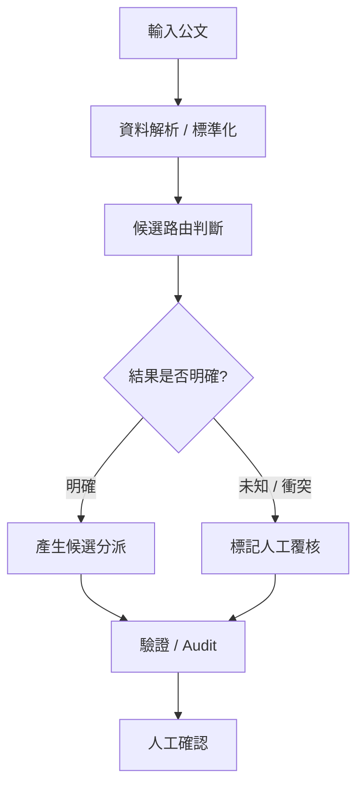
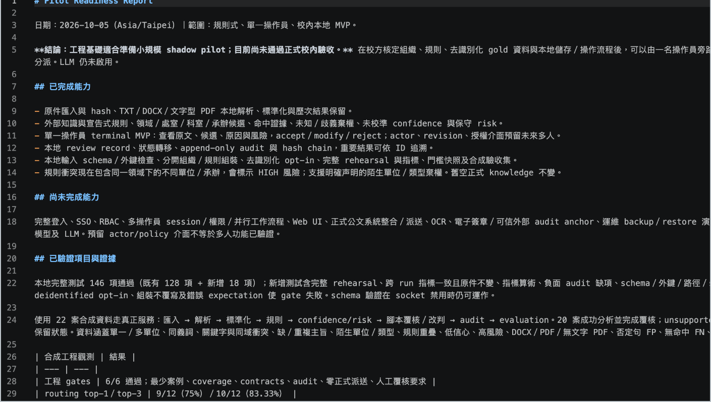
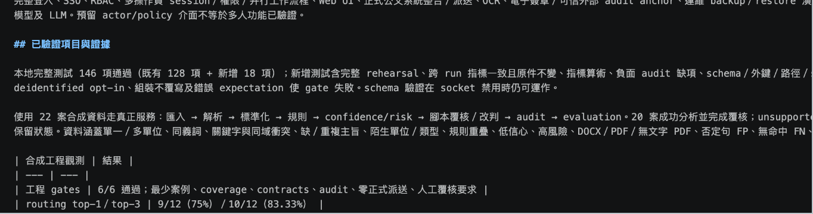
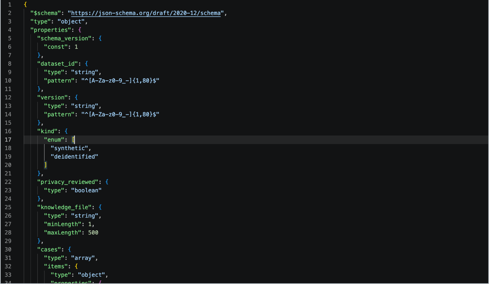

# 公文智能分流系統
### 從「自動分類」到「知道什麼時候應該交給人判斷」

> 一個以校務公文處理為情境，探索 Document Routing、Human-in-the-loop、風險控制與可驗證自動化流程的系統專案。

---

# 1. 專案摘要

| 項目 | 內容 |
|---|---|
| 專案類型 | Document Routing / Decision Support |
| 核心方向 | 公文分類、路由、未知與衝突處理、人工覆核 |
| 開發方式 | AI-assisted development |
| 我的角色 | 問題定義、資料規格、流程設計、風險判斷、測試與驗收 |
| AI 角色 | 程式實作、重構、測試與文件整理輔助 |
| 測試資料 | 22 案合成資料 |
| 自動化測試 | 146 項通過 |
| Engineering Gates | 6 / 6 通過 |
| Audit | 367 / 367 通過 |
| 正式自動分派 | 0 |
| 專案狀態 | Pilot Readiness 已建立，尚未進行真實校內 Shadow Pilot |

---

# 2. 我想解決什麼問題？

學校每天會收到不同種類的公文。

表面上，這似乎只是：

> 「讀取一份公文，再判斷要交給哪個單位。」

但實際上會遇到更複雜的情況：

- 同一份公文可能涉及多個單位
- 部分資訊不足
- 文字可能模糊或存在衝突
- 相似內容不一定代表相同承辦單位
- 系統可能沒有看過某種類型
- 錯誤分派可能造成行政延誤
- 真實公文可能包含敏感資訊

因此我逐漸發現，真正重要的問題不是：

> 「能不能自動分類？」

而是：

> **「什麼情況下系統可以提出建議，什麼情況下應該承認不確定並交給人處理？」**

---

# 3. 系統流程



這個系統的目標不是完全移除人工，而是讓自動化與人工形成：

**Human-in-the-loop**

的決策流程。

---

# 4. 為什麼我不希望系統「什麼都回答」？

如果一個系統被迫對每一份公文都給出答案，即使它其實沒有足夠資訊，也可能產生看似合理但錯誤的結果。

因此我加入兩個重要概念：

## Unknown

代表：

> 系統目前沒有足夠依據做可靠判斷。

遇到這種情況，不應該硬猜。

---

## Conflict

代表：

> 多個規則、候選或證據之間存在衝突。

這種情況也不適合直接自動分派。

因此 Unknown / Conflict 最終會被送到：

**人工覆核**

而不是被包裝成「系統很有信心」。

---

# 5. Human-in-the-loop

我希望系統扮演的角色不是：

> 「取代行政人員。」

而是：

> **「先整理候選與證據，把需要人判斷的案例清楚標示出來。」**

因此流程更接近：

```text
公文
↓
系統分析
↓
候選結果
↓
Confidence / Unknown / Conflict
↓
人工覆核
↓
正式決定
```

目前正式自動分派數量維持：

**0**

因為在尚未以真實校內資料完成驗證前，我不希望把合成資料上的成功直接當成真實環境中的可靠性。

---

# 6. 資料與驗收框架

目前已建立：

- 資料格式與 schema
- 22 案合成測試資料
- Unknown 判定
- Conflict 判定
- 人工覆核流程
- Audit 機制
- 正式驗收框架
- Pilot Readiness Report

這些工作的目的不是只證明：

> 「程式跑得動。」

而是確認：

- 資料是否符合規格？
- 每個流程是否留下紀錄？
- 未知案例是否真的被攔截？
- 衝突案例是否會被送去覆核？
- 系統是否會越過不應該越過的安全條件？

---

# 7. 測試與工程驗證

## Pilot Readiness Report

目前已建立正式驗收框架，並整理系統已完成能力、尚未完成能力與進入 Shadow Pilot 前的條件。



---

## 工程驗證結果

目前以合成資料進行完整 rehearsal，包含 146 項測試與 6/6 engineering gates。



---

## 資料規格與隱私設計

資料 schema 明確區分 synthetic 與 deidentified 資料，並保留 privacy review 等欄位，避免將測試資料與真實公文混為一談。


---

## Engineering Gates

**6 / 6 通過**

這些 Gate 用來確認系統是否達到進入下一階段測試的最低工程條件。

---

## Audit

**367 / 367 通過**

Audit 的目的在於確認系統各階段的行為與紀錄可以被追蹤，而不是只有最後的分類結果。

---

## 正式自動分派

**0**

這個數字是我刻意保留的。

因為：

> **合成資料上的成功，不等於真實校內環境中的準確率。**

在進入真實資料 Shadow Pilot 前，我不希望把系統描述成已經能安全自動處理正式公文。

---

# 8. AI 協作開發方式

本專案同樣採用 **AI-assisted development**。

## 我主要負責

- 問題定義
- 流程與資料規格設計
- schema 設計方向
- Unknown / Conflict 的政策判斷
- Human-in-the-loop 流程
- 測試與驗收條件
- 風險分析
- 是否接受實作結果的最終判斷

## Codex / LLM 主要協助

- 程式實作
- 重構
- 測試撰寫
- 文件產生
- 重複性工程工作
- 技術方案探索

我的原則仍然是：

> **AI 產生的實作必須可以被測試與驗證，而不能因為看起來合理就直接接受。**

---

# 9. 目前沒有做的事情

我特別保留以下限制，不將它們包裝成成果：

## 尚未使用真實校內公文完成正式驗證

目前主要驗證資料為：

**22 案合成資料**

因此不能直接推論為：

> 「在真實學校公文上已有相同準確率。」

---

## Confidence 尚未完成正式校準

系統目前還不能宣稱：

> 某個 confidence 數字就代表真實世界中相同的正確率。

這需要未來真實資料才能進一步評估。

---

## 人工覆核目前仍主要是流程模擬

Human Review 流程已建立，但目前的驗收並不等於真實行政人員長期使用後的結果。

---

## 尚未啟用 LLM 作為正式路由模型

目前系統仍以可驗證的工程流程為核心。

LLM 並未直接成為正式公文分派決策者。

這是刻意保留的設計，因為我希望先建立可驗證 baseline，再判斷 AI 模型真正能增加多少價值。

---

# 10. 為什麼這些限制反而重要？

一開始我很容易把專案成果理解成：

> 「準確率越高越好。」

但後來我開始發現，在行政流程中還有另一個重要問題：

> **錯誤的自動化可能比沒有自動化更危險。**

如果系統不知道答案，最好的行為可能不是猜一個答案，而是：

> **承認不確定。**

因此這個專案讓我開始接觸：

- Human-in-the-loop
- Uncertainty
- Abstention
- Auditability
- Risk Control
- Reliable AI

等問題。

---

# 11. 下一階段：Shadow Pilot

下一步不是直接讓系統正式分派公文。

預計流程是：

```text
取得經核定且可安全使用的真實公文
↓
去識別化 / 安全處理
↓
系統在背景產生候選結果
↓
不影響原本正式行政流程
↓
與人工真實結果比較
↓
Error Analysis
↓
Confidence Calibration
↓
決定是否適合進一步 Pilot
```

這種模式稱為：

**Shadow Pilot**

也就是讓系統先在背景接受真實資料測試，但不直接影響正式行政決策。

---

# 12. 長期方向

如果 Shadow Pilot 證明系統具有價值，未來希望進一步探索：

- 真實公文資料分類
- Confidence Calibration
- Human-in-the-loop AI
- Retrieval / LLM 輔助
- 可解釋的候選推薦
- Audit trail
- 隱私與內網部署
- 可靠行政 AI

---

# 13. 我從這個專案學到什麼？

這個專案一開始看起來只是：

> 「做一個公文分類器。」

但後來我真正開始思考的是：

> **系統什麼時候應該回答？**

以及：

> **系統什麼時候應該選擇不回答？**

我逐漸理解，一個真正可以進入現實環境的系統，不只需要功能與準確率。

它還需要：

- 錯誤處理
- 不確定性處理
- 人工覆核
- 測試
- Audit
- 風險控制
- 可追蹤的證據

---

# 一句話總結

> **這個專案讓我理解，可靠的自動化不是讓系統什麼都決定，而是讓系統知道什麼時候可以協助人，什麼時候應該把決定交還給人。**
